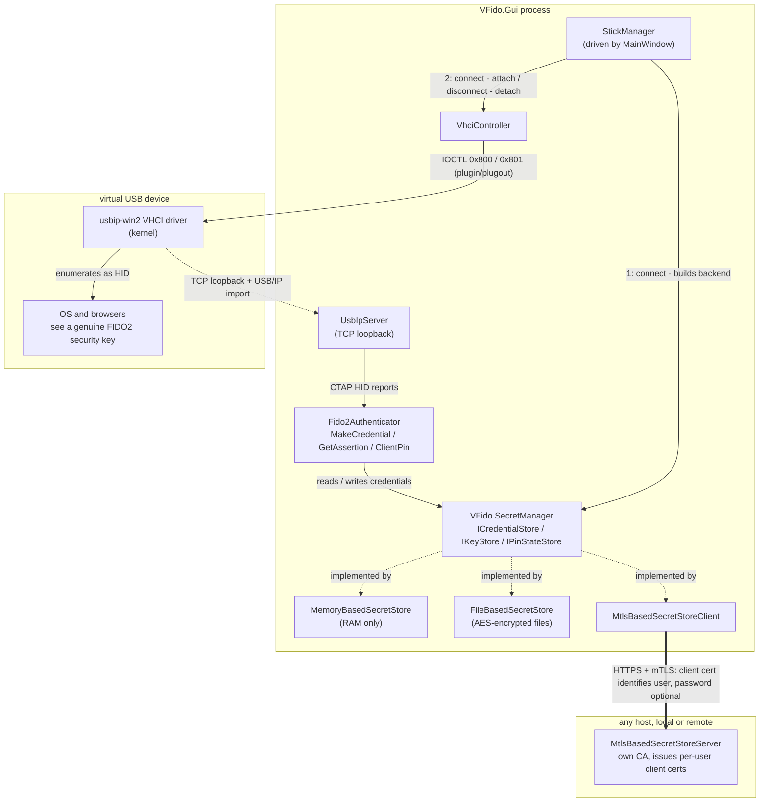

# VirtualFido

VirtualFido is a Windows software FIDO2/CTAP2 security key. It emulates a USB security key device via USB/IP and a virtual host controller interface (VHCI), so the OS and browsers see it as a real hardware authenticator — without needing a physical key.

## How it works



- **VFido.Core** implements the CTAP2 authenticator protocol (`MakeCredential`, `GetAssertion`, `ClientPin`, `GetInfo`, ...), CTAP HID framing, and a USB/IP server that presents the virtual device over the VHCI driver so Windows recognizes it as a USB HID FIDO device.
- **VFido.Gui** is an [Avalonia](https://avaloniaui.net/) desktop application that runs the virtual authenticator, shows a user-presence approval window for each authentication request, and lets you manage stored credentials.
- **VFido.SecretManager** defines the credential/secret storage abstraction, with pluggable backends:
  - `VFido.SecretManager.MemoryBasedSecretStore` — in-memory, non-persistent.
  - `VFido.SecretManager.FileBasedSecretStore` — encrypted on-disk storage.
  - `VFido.SecretManager.MtlsBasedSecretStoreClient` / `...Server` — remote secret storage over mutual-TLS, allowing credentials to be kept on a separate machine/service. The server runs its own CA (`Pki/CaManager`) and issues each user a client certificate; the certificate's CN identifies the user (there's no client-supplied username), and users created with a password additionally exchange it for a short-lived session token via `/login` before their first request — passwordless (`--no-password`) users authenticate with the mTLS handshake alone. Provisioning (CA init, user creation/revocation) is done via the server's admin CLI (`Cli/AdminCommands`, e.g. `init`, `create-user`, `revoke-user`).
- **VirtualFido.Tests** contains the test suite.

## Requirements

- Windows 10/11
- [.NET 8 SDK](https://dotnet.microsoft.com/download/dotnet/8.0)
- A VHCI-capable USB/IP driver installed on the host (required for the virtual device to appear as a real USB device) — see [usbip-win2](https://github.com/vadimgrn/usbip-win2) (bundled here as [USBip-0.9.7.3-x64-release.exe](USBip-0.9.7.3-x64-release.exe?raw=true))

## Building

```powershell
dotnet build VirtualFido.sln
```

## Running

```powershell
dotnet run --project VFido.Gui
```

## Testing

```powershell
dotnet test
```

## Running the mTLS secret store server

`VFido.SecretManager.MtlsBasedSecretStoreServer` is an optional standalone service for keeping credentials on a separate machine, accessed over mutual TLS. Configuration lives in its `appsettings.json` under the `MtlsBasedSecretStoreServer` section (listen port, certificate paths, PKI/secrets root directories, session token lifetime). In the GUI, add a stick pointing at the server's address (the Add Stick dialog defaults to `https://localhost:5443`) and select the mTLS client certificate issued by `create-user`.

```powershell
# One-time: generate the CA, server certificate, and master protection certificate
dotnet run --project VFido.SecretManager.MtlsBasedSecretStoreServer -- init

# Provision a user (mTLS client certificate + optional login password)
dotnet run --project VFido.SecretManager.MtlsBasedSecretStoreServer -- create-user <username> [--no-password]

# Revoke a previously issued client certificate
dotnet run --project VFido.SecretManager.MtlsBasedSecretStoreServer -- revoke-user <username>

# Start the server
dotnet run --project VFido.SecretManager.MtlsBasedSecretStoreServer
```

## Project layout

```
VFido.Core/                              CTAP2/USB-IP/VHCI core protocol implementation
VFido.Gui/                                Avalonia desktop UI (approval window, credential management)
VFido.SecretManager/                      Secret store abstractions and crypto
VFido.SecretManager.MemoryBasedSecretStore/       In-memory secret store
VFido.SecretManager.FileBasedSecretStore/         File-based secret store
VFido.SecretManager.MtlsBasedSecretStoreClient/   mTLS remote secret store client
VFido.SecretManager.MtlsBasedSecretStoreServer/   mTLS remote secret store server
VirtualFido.Tests/                        Test suite
```

## Certificate-encrypted passkey backups

For a connected memory or file-backed stick, open **Credentials**:

1. Choose **Create transfer certificate**. Enter and confirm a password, then save the private `.pfx` and public `.cer` as separate files. Keep the PFX and password privately; share only the CER. The certificate is self-signed and does not need installation in the Windows certificate store.
2. Check the credentials to back up and choose **Export selected**. Select the recipient CER, verify its SHA-256 fingerprint, and save the encrypted `.vfidobackup` file. Export needs no access to the private PFX. Source credentials remain in place.
3. On the destination stick, choose **Import passkeys**, select the backup and matching PFX, enter its password, and review the account list before importing. A memory destination remains temporary; use a file-backed stick for persistence.

The backup preserves credential IDs, RP IDs, user handles, ES256/P-256 private keys, discoverability, credential protection, and signature counters. Identical existing credentials are skipped without overwriting their metadata or counters. Conflicting credential IDs reject the entire import before any writes. Write failures trigger rollback of newly created keys and metadata; rollback errors are reported. Import is not a crash-atomic transaction: after a process or machine interruption, inspect the destination before retrying.

Each export uses a fresh AES-256-GCM key and nonce; RSA-OAEP-SHA256 encrypts the AES key for the recipient certificate. The version, encryption algorithm, certificate fingerprint, and wrapped key are authenticated with the payload. Private-key and account data are inside the encrypted payload. Encryption does not authenticate the sender: anyone with the public CER can create a backup addressed to it. Only import files from a trusted source.

The generated RSA-3072 recipient certificate lasts five years. Expired certificates cannot be used for new exports, but their private keys can still restore old backups. Files are limited to 64 MiB and batches to 10,000 credentials. mTLS remote stores and TPM stores do not currently expose backup/import capabilities.

This is a **VirtualFido-specific backup format**, not FIDO CXP or a CXF-conformant export. [CXF 1.0](https://fidoalliance.org/specs/cx/cxf-v1.0-ps-20250814.html#dict-passkey) excludes credentials with nonzero signature counters, whereas this backup preserves existing VirtualFido counters. Restoring an old backup or using multiple copies concurrently can cause relying parties to detect counter regressions and reject sign-ins. This feature does not change credential backup eligibility, copy authenticator PINs or attestation keys, or delete source credentials.
