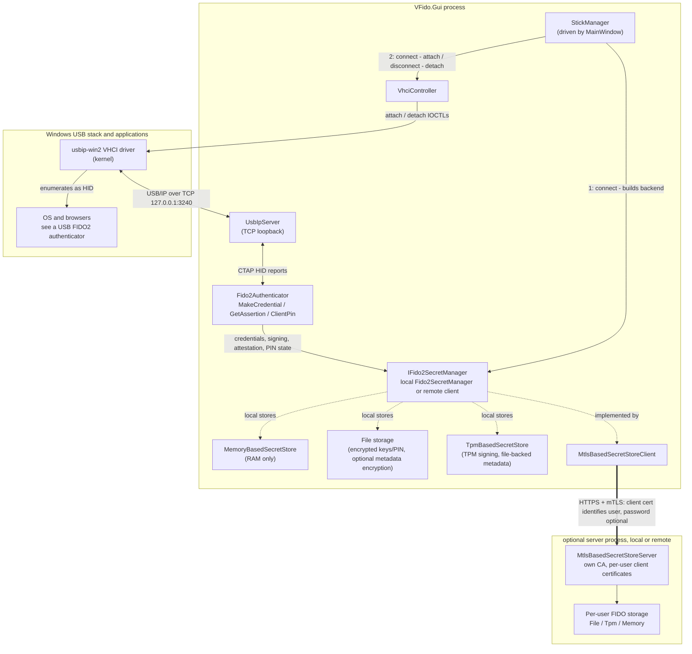

# VirtualFido

VirtualFido is a Windows software FIDO2/CTAP2 security key. It emulates a USB security key device via USB/IP and a virtual host controller interface (VHCI), so Windows and browsers can use it as a USB FIDO2 authenticator without a physical security key.

## How it works



Connecting a stick builds its secret manager, registers the virtual USB device with the loopback USB/IP server, and attaches it through the VHCI driver. Windows then sends CTAP requests over USB HID. Local backends handle storage and signing in the GUI process; the mTLS client forwards secret-manager operations to the server while USB emulation and user-presence approval stay in the GUI. Only one stick is connected at a time; connecting another disconnects the current stick.

- **VFido.Core** implements the CTAP2 authenticator protocol (`MakeCredential`, `GetAssertion`, `ClientPin`, `GetInfo`, ...), CTAP HID framing, and a USB/IP server that presents the virtual device over the VHCI driver so Windows recognizes it as a USB HID FIDO device.
- **VFido.Gui** is an [Avalonia](https://avaloniaui.net/) desktop application that runs the virtual authenticator, shows approval windows for registration and sign-in requests that require user presence, and lets you manage stored credentials.
- **VFido.SecretManager** defines the credential/secret storage abstraction, with pluggable backends:
  - `VFido.SecretManager.MemoryBasedSecretStore` - in-memory, non-persistent.
  - `VFido.SecretManager.FileBasedSecretStore` - encrypted private keys and PIN state on disk, with optional credential metadata encryption.
  - `VFido.SecretManager.TpmBasedSecretStore` - signing inside the local TPM, file-backed metadata, encrypted PIN state, and a portable master recovery PFX.
  - `VFido.SecretManager.MtlsBasedSecretStoreClient` / `...Server` - remote secret storage over mutual-TLS, allowing credentials to be kept on a separate machine/service. The server runs its own CA (`Pki/CaManager`) and issues each user a client certificate; the certificate's CN identifies the user (there's no client-supplied username), and users created with a password additionally exchange it for a short-lived session token via `/login` before their first request - passwordless (`--no-password`) users authenticate with the mTLS handshake alone. The server supports File, Tpm, and Memory storage providers, a first-run setup wizard, a management dashboard, and an admin CLI (`init`, `create-user`, `revoke-user`).
- **VFido.SecretManager.Protection** provides shared payload encryption and password unlocking for file-backed storage and server CA protection.
- **VirtualFido.Tests** contains the test suite.

## Requirements

- Windows 10/11
- [.NET 8 SDK](https://dotnet.microsoft.com/download/dotnet/8.0)
- A VHCI-capable USB/IP driver installed on the Windows GUI host (the standalone secret store server does not need it): [usbip-win2](https://github.com/vadimgrn/usbip-win2) (bundled here as [USBip-0.9.7.3-x64-release.exe](USBip-0.9.7.3-x64-release.exe?raw=true))
- For TPM-backed storage, a supported local TPM accessible to the process. The GUI uses Windows TBS.

## Building

```powershell
dotnet build VirtualFido.sln
```

## Running

```powershell
dotnet run --project VFido.Gui
```

Choose **Add stick**, select a storage backend, supply its settings, and create the stick. Select **Connect** to attach the virtual USB authenticator. The GUI prompts for user presence during authentication; open **Credentials** to manage the connected stick's passkeys.

Stick configuration and local persistent data live under `VFido/<stick-name>/` next to the GUI executable, rather than in AppData. With `dotnet run`, that is the build output directory. Keep the complete stick folder when backing up or moving a persistent stick. Memory-backed credentials are lost on disconnect or process exit.

File and TPM sticks encrypt credential metadata by default. Disabling **Encrypt credential metadata** exposes account details and permits metadata edits; private keys and PIN state retain their protection. Changing an existing directory's encryption mode requires explicit conversion. See [storage and encryption details](VFido.SecretManager.MtlsBasedSecretStoreServer/STORAGE.md).

## Testing

```powershell
dotnet test VirtualFido.Tests
```

Hardware TPM integration tests are opt-in. See [TPM integration and tests](VFido.SecretManager.TpmBasedSecretStore/README.md#integration-and-tests) for the environment flag and test command.

## Running the mTLS secret store server

`VFido.SecretManager.MtlsBasedSecretStoreServer` is an optional standalone service for keeping credentials on a separate machine, accessed over mutual TLS.

### First-run setup

On a fresh installation, start the server without arguments:

```powershell
dotnet run --project VFido.SecretManager.MtlsBasedSecretStoreServer
```

The local setup wizard opens in a browser. Choose the storage provider (`File`, `Tpm`, or `Memory`), credential metadata encryption, server DNS name or IP, HTTPS port, CA passphrase, and first administrator. Download the administrator PFX and root CA. For TPM storage, also download the recovery PFX and keep its password offline. Select **Close setup and start server** to switch to the mTLS service. Later starts go directly to the configured server.

Setup binds only to `127.0.0.1` on a random port and prints its private URL if the browser cannot open. Run it on the server machine or forward that loopback port through SSH. Existing or partial installations are not overwritten.

Configuration is read from `appsettings.json` next to the server executable, under `MtlsBasedSecretStoreServer`. Setup writes to that file, so the directory must be writable. Relative certificate and storage paths also resolve against the executable directory. The default HTTPS port is `5443`, storage provider is `File`, metadata encryption is enabled, and login tokens last 30 minutes. Changing the provider or metadata encryption setting does not convert existing data. See [server storage, TPM recovery, and encryption](VFido.SecretManager.MtlsBasedSecretStoreServer/STORAGE.md).

### Connect a GUI stick

Provision a user through the [management dashboard](#server-management-dashboard) or CLI. In **Add stick > mTLS server**, enter the server's HTTPS address (default `https://localhost:5443`), the user's client PFX and its password, and the server CA certificate (`ClientCaCertificatePath`, default `certs/ca.crt` on the server). Enter the login password for password-protected users; leave it blank for certificate-only users. Use the hostname or IP configured during server setup. The login password and PFX password serve separate purposes.

### Command-line administration

The CLI remains available for manual provisioning and partial-installation repair. `init` issues a server certificate for `localhost`; use the first-run wizard to choose a different server name on a fresh installation. Passwords and CA passphrases are prompted for interactively.

```powershell
# One-time manual initialization (skip if already configured by the wizard)
dotnet run --project VFido.SecretManager.MtlsBasedSecretStoreServer -- init

# Provision a password-protected user (replace alice with your username)
dotnet run --project VFido.SecretManager.MtlsBasedSecretStoreServer -- create-user alice

# Alternatively, provision a certificate-only user
dotnet run --project VFido.SecretManager.MtlsBasedSecretStoreServer -- create-user bob --no-password

# Revoke a previously issued client certificate; restart the server afterward
dotnet run --project VFido.SecretManager.MtlsBasedSecretStoreServer -- revoke-user alice

# Start the server
dotnet run --project VFido.SecretManager.MtlsBasedSecretStoreServer
```

### Logging

Server logging uses NLog via the existing `ILogger` calls. `nlog.config` is copied alongside the executable on build/publish and controls console output plus JSON lines in `logs/server.log` relative to the executable directory. Files rotate daily or at 10 MiB, keeping up to 30 archives. User, certificate thumbprint, connection and request context are included in logged events; credential IDs use hashed fingerprints. `Logging:LogLevel` in `appsettings.json` still controls category thresholds. Connection, login and passkey signing events are logged; a signed assertion does not confirm acceptance by the relying website.

## Certificate-encrypted credential exchange

For a connected memory or file-backed stick, open **Credentials**:

1. Choose **Create transfer certificate**. Enter and confirm a password, then save the private `.pfx` and public `.cer` as separate files. Keep the PFX and password privately; share only the CER. The certificate is self-signed and does not need installation in the Windows certificate store.
2. Check the credentials to export and choose **Export selected**. Select the recipient CER, verify its SHA-256 fingerprint, and save the encrypted `.cxf.encrypted` file. Export needs no access to the private PFX and no export request. Source credentials remain in place.
3. On the destination stick, choose **Import passkeys**, select the backup and matching PFX, enter its password, and review the account list before importing. A memory destination remains temporary; use a file-backed stick for persistence.

The backup preserves credential IDs, RP IDs, user handles, ES256/P-256 private keys, discoverability, credential protection, and signature counters. Identical existing credentials are skipped without overwriting their metadata or counters. Conflicting credential IDs reject the entire import before any writes. Write failures trigger rollback of newly created keys and metadata; rollback errors are reported. Import is not a crash-atomic transaction: after a process or machine interruption, inspect the destination before retrying.

Each export uses a fresh ephemeral P-256 key with RFC 9180 HPKE base mode: DHKEM(P-256, HKDF-SHA256), HKDF-SHA256, AES-128-GCM (KEM 16, KDF 1, AEAD 1). The recipient's public key comes from the CER; the matching PFX provides the private key for import. Response metadata and the JWE protected header are cryptographically bound to the payload. Private-key and account data are encrypted. Base mode does not authenticate the sender: anyone with the public CER can create a response addressed to it. Only import files from a trusted source.

The generated P-256 recipient certificate permits key agreement and lasts five years. Create a new transfer certificate to replace earlier RSA transfer certificates; they cannot be used with this HPKE suite. Expired certificates cannot be used for new exports, but their private keys can still restore existing responses. Files are limited to 64 MiB, decrypted CXF to 32 MiB, and batches to 10,000 credentials. TPM stores support import while private-key export stays disabled. mTLS remote stores do not currently expose export/import capabilities.

The decrypted payload uses the [CXF 1.0](https://fidoalliance.org/specs/cx/cxf-v1.0-ps-20250814.html#dict-passkey) header, account, item, and passkey structures, including base64url credential IDs, user handles, and PKCS#8 keys. A named item extension, `virtualfido.local/CredentialMetadata`, binds discoverability, credential protection, signature counter, and counter policy to each credential ID. **All selected credentials are included, including those with nonzero counters.** Since CXF excludes nonzero counters, this VirtualFido profile does not claim strict CXF conformance. Extension-free CXF passkeys import as discoverable credentials with default protection and permanently zero counters; VirtualFido transfers preserve their original counter policy. Known unsupported FIDO2 extensions are rejected before any writes rather than silently discarding their data.

The outer JSON follows the [October 2024 CXP ExportResponse](https://fidoalliance.org/specs/cx/cxp-v1.0-wd-20241003.html#sctn-export-response) layout: `version: 0`, `hpke`, `archive: "deflate"`, `exporter`, and base64url `payload`. `hpke` contains `mode: "base"`, the numeric suite identifiers, and the ephemeral public key as a P-256 JWK. The payload is a DEFLATE-compressed ZIP containing one `CXP-Export/index.jwe` compact JWE, with `alg: "dir"`, `enc: "A128GCM"`, and the recipient certificate's SHA-256 fingerprint as `kid`. HPKE sequence zero supplies its encryption key and IV; the encoded protected header is the AEAD additional data. The JWE plaintext is the CXF document. ZIP entry count, paths, and expanded sizes are checked before accepting a payload.

This is a **request-free certificate profile**, not a complete standard CXP ceremony. It fixes the suite and archive instead of negotiating a request. To bind the response metadata, HPKE `info` is UTF-8 `VirtualFido/CXP/certificate-base/v1` followed by a newline and compact JSON with properties in this exact order: `version`, `hpke`, `archive`, `exporter`; HPKE properties are ordered `mode`, `kem`, `kdf`, `aead`, `key`, and JWK properties `kty`, `crv`, `x`, `y`. Integers are decimal, strings use System.Text.Json's default escaping, and no whitespace is inserted. Other applications need support for this profile and the counter metadata extension to restore files with full fidelity. Earlier custom RSA envelopes and legacy backup formats are no longer accepted. Restoring an old export or using multiple copies concurrently can cause relying parties to detect counter regressions and reject sign-ins. This feature does not change credential backup eligibility, copy authenticator PINs or attestation keys, or delete source credentials.

## TPM-backed sticks (Windows)

In **Add stick**, choose **TPM 2.0 (Windows)**. Select a master recovery PFX or create a new one, then set a separate username and metadata password. Connect uses the metadata password; the PFX password is needed only during setup or recovery. PIN state and retry counts persist across reconnects.

Use **Credentials > Export TPM backup ZIP** to save wrapped keys, metadata, configuration, authentication files, and PIN state together. The ZIP has no additional password and excludes the TPM-local `master.json`; keep the recovery PFX separately. Restore the extracted stick folder while disconnected, then restore the master before connecting, even on the original TPM.

To recover a copied stick folder on another TPM, disconnect it and use **Edit > Restore master on this TPM** with the original PFX. Keep the PFX, its password, the complete stick folder, and the metadata password. See [TPM setup and recovery](VFido.SecretManager.TpmBasedSecretStore/README.md) for details.

## Server management dashboard

The mTLS secret store server serves a management dashboard at
`https://localhost:5443/admin` (use your configured hostname and port).
It shows uptime, server certificate expiry, provisioned users, credential counts for the selected storage provider, and unexpired password-session counts. User inventory can be searched
and refreshes every 30 seconds. The dashboard does not decrypt stored credentials
or expose passwords or bearer tokens in its inventory.

The first-run wizard automatically allowlists the administrator certificate it creates. Import the downloaded administrator PFX into your browser's personal certificate store, trust the downloaded root CA, and open `/admin`.

To grant access to another administrator or configure an installation initialized through the CLI:

1. Provision an administrator client certificate with the existing `create-user`
   command and import its `client.pfx` into your browser's personal certificate store.
2. Obtain that certificate's thumbprint from the certificate viewer. Add it to
   `MtlsBasedSecretStoreServer.AdminCertificateThumbprints` in the server's
   `appsettings.json`, for example:

   ```json
   "AdminCertificateThumbprints": ["YOUR_ADMIN_CLIENT_CERTIFICATE_THUMBPRINT"]
   ```

3. Restart the server, trust your server's CA on the browser machine, and open
   `/admin`. Select the administrator client certificate when the browser prompts.

An empty `AdminCertificateThumbprints` allowlist denies dashboard access. The checked-in `appsettings.json` contains a thumbprint; replace it with your own administrator certificate thumbprint, or clear the list to disable access. Ordinary client
certificates do not grant administrator access. Allowlisted certificates must still
pass the server's existing mTLS validation. All dashboard assets and inventory
endpoints require administrator access and send `Cache-Control: no-store`.

Use **Create user** to supply a username, CA passphrase, login password (or select
certificate-only authentication), and optional PFX password. The dashboard downloads
the new client PFX and saves a server copy in the user's directory. Existing users
cannot be overwritten. New usernames use 1-64 ASCII letters, numbers, underscores,
or hyphens, starting with a letter or number; Windows device names are excluded.

Use **Revoke** beside a user to revoke their issued certificate. Older users without
public certificate metadata require their existing PFX password. Dashboard revocations
persist across restarts and block subsequent requests immediately, including on existing
TLS connections; requests already in progress may complete. Stored credentials are retained.
Revoking the certificate currently used to administer the dashboard is blocked; use a
different administrator certificate for that operation.

The `create-user` and `revoke-user` CLI commands remain available. CLI revocations still
require a server restart. PFX presence alone is not proof of certificate validity;
legacy certificate status is shown as unknown until public metadata is available.
Session counts cover unexpired password login tokens, not open connections or
certificate-only users (revoked certificates cannot use their remaining tokens).

## Project layout

| Project | Purpose |
| --- | --- |
| `VFido.Core` | CTAP2, CTAP HID, USB/IP, and VHCI integration |
| `VFido.Gui` | Avalonia desktop UI and stick management |
| `VFido.SecretManager` | Secret store abstractions, manager, and credential exchange |
| `VFido.SecretManager.Protection` | Shared payload encryption and password unlocking |
| `VFido.SecretManager.MemoryBasedSecretStore` | In-memory secret store |
| `VFido.SecretManager.FileBasedSecretStore` | File-backed keys, credential metadata, and PIN state |
| `VFido.SecretManager.TpmBasedSecretStore` | TPM signing and wrapped-key recovery |
| `VFido.SecretManager.MtlsBasedSecretStoreClient` | Remote secret store client |
| `VFido.SecretManager.MtlsBasedSecretStoreServer` | mTLS service, setup wizard, dashboard, and admin CLI |
| `VirtualFido.Tests` | Test suite |
