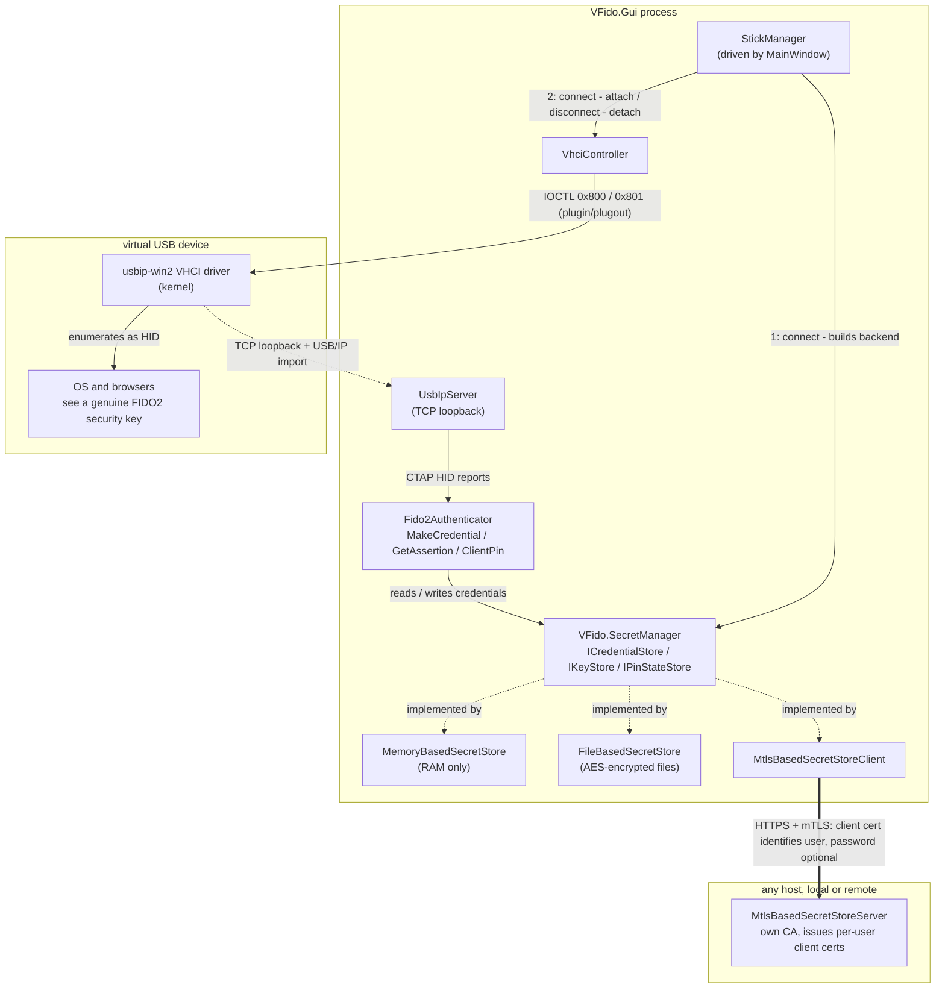

# VirtualFido

VirtualFido is a Windows software FIDO2/CTAP2 security key. It emulates a USB security key device via USB/IP and a virtual host controller interface (VHCI), so the OS and browsers see it as a real hardware authenticator — without needing a physical key.

## How it works



- **VFido.Core** implements the CTAP2 authenticator protocol (`MakeCredential`, `GetAssertion`, `ClientPin`, `GetInfo`, ...), CTAP HID framing, and a USB/IP server that presents the virtual device over the VHCI driver so Windows recognizes it as a USB HID FIDO device.
- **VFido.Gui** is an [Avalonia](https://avaloniaui.net/) desktop application that runs the virtual authenticator, shows a user-presence approval window for each authentication request, and lets you manage stored credentials.
- **VFido.SecretManager** defines the credential/secret storage abstraction, with pluggable backends:
  - `VFido.SecretManager.MemoryBasedSecretStore` — in-memory, non-persistent.
  - `VFido.SecretManager.FileBasedSecretStore` — encrypted on-disk storage.
  - `VFido.SecretManager.MtlsBasedSecretStoreClient` / `...Server` — remote secret storage over mutual-TLS, allowing credentials to be kept on a separate machine/service. The server runs its own CA (`Pki/CaManager`) and issues each user a client certificate; the certificate's CN identifies the user (there's no client-supplied username), and users created with a password additionally exchange it for a short-lived session token via `/login` before their first request — passwordless (`--no-password`) users authenticate with the mTLS handshake alone. Provisioning (CA init, user creation/revocation) is done via the server's admin CLI (`Cli/AdminCommands`, e.g. `init`, `create-user`, `revoke-user`).
- **VirtualFido.Tests** contains the test suite.

## Requirements

- Windows 10/11
- [.NET 8 SDK](https://dotnet.microsoft.com/download/dotnet/8.0)
- A VHCI-capable USB/IP driver installed on the host (required for the virtual device to appear as a real USB device) — see [usbip-win2](https://github.com/vadimgrn/usbip-win2) (bundled here as [USBip-0.9.7.3-x64-release.exe](USBip-0.9.7.3-x64-release.exe?raw=true))

## Building

```powershell
dotnet build VirtualFido.sln
```

## Running

```powershell
dotnet run --project VFido.Gui
```

## Testing

```powershell
dotnet test
```

## Running the mTLS secret store server

`VFido.SecretManager.MtlsBasedSecretStoreServer` is an optional standalone service for keeping credentials on a separate machine, accessed over mutual TLS. Configuration lives in its `appsettings.json` under the `MtlsBasedSecretStoreServer` section (listen port, certificate paths, PKI/secrets root directories, session token lifetime). In the GUI, add a stick pointing at the server's address (the Add Stick dialog defaults to `https://localhost:5443`) and select the mTLS client certificate issued by `create-user`.

```powershell
# One-time: generate the CA, server certificate, and master protection certificate
dotnet run --project VFido.SecretManager.MtlsBasedSecretStoreServer -- init

# Provision a user (mTLS client certificate + optional login password)
dotnet run --project VFido.SecretManager.MtlsBasedSecretStoreServer -- create-user <username> [--no-password]

# Revoke a previously issued client certificate
dotnet run --project VFido.SecretManager.MtlsBasedSecretStoreServer -- revoke-user <username>

# Start the server
dotnet run --project VFido.SecretManager.MtlsBasedSecretStoreServer
```

## Project layout

```
VFido.Core/                              CTAP2/USB-IP/VHCI core protocol implementation
VFido.Gui/                                Avalonia desktop UI (approval window, credential management)
VFido.SecretManager/                      Secret store abstractions and crypto
VFido.SecretManager.MemoryBasedSecretStore/       In-memory secret store
VFido.SecretManager.FileBasedSecretStore/         File-based secret store
VFido.SecretManager.MtlsBasedSecretStoreClient/   mTLS remote secret store client
VFido.SecretManager.MtlsBasedSecretStoreServer/   mTLS remote secret store server
VirtualFido.Tests/                        Test suite
```

## Certificate-encrypted credential exchange

For a connected memory or file-backed stick, open **Credentials**:

1. Choose **Create transfer certificate**. Enter and confirm a password, then save the private `.pfx` and public `.cer` as separate files. Keep the PFX and password privately; share only the CER. The certificate is self-signed and does not need installation in the Windows certificate store.
2. Check the credentials to export and choose **Export selected**. Select the recipient CER, verify its SHA-256 fingerprint, and save the encrypted `.cxf.encrypted` file. Export needs no access to the private PFX and no export request. Source credentials remain in place.
3. On the destination stick, choose **Import passkeys**, select the backup and matching PFX, enter its password, and review the account list before importing. A memory destination remains temporary; use a file-backed stick for persistence.

The backup preserves credential IDs, RP IDs, user handles, ES256/P-256 private keys, discoverability, credential protection, and signature counters. Identical existing credentials are skipped without overwriting their metadata or counters. Conflicting credential IDs reject the entire import before any writes. Write failures trigger rollback of newly created keys and metadata; rollback errors are reported. Import is not a crash-atomic transaction: after a process or machine interruption, inspect the destination before retrying.

Each export uses a fresh ephemeral P-256 key with RFC 9180 HPKE base mode: DHKEM(P-256, HKDF-SHA256), HKDF-SHA256, AES-128-GCM (KEM 16, KDF 1, AEAD 1). The recipient's public key comes from the CER; the matching PFX provides the private key for import. Response metadata and the JWE protected header are cryptographically bound to the payload. Private-key and account data are encrypted. Base mode does not authenticate the sender: anyone with the public CER can create a response addressed to it. Only import files from a trusted source.

The generated P-256 recipient certificate permits key agreement and lasts five years. Create a new transfer certificate to replace earlier RSA transfer certificates; they cannot be used with this HPKE suite. Expired certificates cannot be used for new exports, but their private keys can still restore existing responses. Files are limited to 64 MiB, decrypted CXF to 32 MiB, and batches to 10,000 credentials. TPM stores support import while private-key export stays disabled. mTLS remote stores do not currently expose export/import capabilities.

The decrypted payload uses the [CXF 1.0](https://fidoalliance.org/specs/cx/cxf-v1.0-ps-20250814.html#dict-passkey) header, account, item, and passkey structures, including base64url credential IDs, user handles, and PKCS#8 keys. A named item extension, `virtualfido.local/CredentialMetadata`, binds discoverability, credential protection, signature counter, and counter policy to each credential ID. **All selected credentials are included, including those with nonzero counters.** Since CXF excludes nonzero counters, this VirtualFido profile does not claim strict CXF conformance. Extension-free CXF passkeys import as discoverable credentials with default protection and permanently zero counters; VirtualFido transfers preserve their original counter policy. Known unsupported FIDO2 extensions are rejected before any writes rather than silently discarding their data.

The outer JSON follows the [October 2024 CXP ExportResponse](https://fidoalliance.org/specs/cx/cxp-v1.0-wd-20241003.html#sctn-export-response) layout: `version: 0`, `hpke`, `archive: "deflate"`, `exporter`, and base64url `payload`. `hpke` contains `mode: "base"`, the numeric suite identifiers, and the ephemeral public key as a P-256 JWK. The payload is a DEFLATE-compressed ZIP containing one `CXP-Export/index.jwe` compact JWE, with `alg: "dir"`, `enc: "A128GCM"`, and the recipient certificate's SHA-256 fingerprint as `kid`. HPKE sequence zero supplies its encryption key and IV; the encoded protected header is the AEAD additional data. The JWE plaintext is the CXF document. ZIP entry count, paths, and expanded sizes are checked before accepting a payload.

This is a **request-free certificate profile**, not a complete standard CXP ceremony. It fixes the suite and archive instead of negotiating a request. To bind the response metadata, HPKE `info` is UTF-8 `VirtualFido/CXP/certificate-base/v1` followed by a newline and compact JSON with properties in this exact order: `version`, `hpke`, `archive`, `exporter`; HPKE properties are ordered `mode`, `kem`, `kdf`, `aead`, `key`, and JWK properties `kty`, `crv`, `x`, `y`. Integers are decimal, strings use System.Text.Json's default escaping, and no whitespace is inserted. Other applications need support for this profile and the counter metadata extension to restore files with full fidelity. Earlier custom RSA envelopes and legacy backup formats are no longer accepted. Restoring an old export or using multiple copies concurrently can cause relying parties to detect counter regressions and reject sign-ins. This feature does not change credential backup eligibility, copy authenticator PINs or attestation keys, or delete source credentials.

### TPM-backed sticks (Windows)

In **Add stick**, choose **TPM 2.0 (Windows)**. Select a master recovery PFX or create a new one, then set a separate username and metadata password. Connect uses the metadata password; the PFX password is needed only during setup or recovery. PIN state and retry counts persist across reconnects.

To recover a copied stick folder on another TPM, disconnect it and use **Edit > Restore master on this TPM** with the original PFX. Keep the PFX, its password, the complete stick folder, and the metadata password. See [TPM setup and recovery](VFido.SecretManager.TpmBasedSecretStore/README.md) for details.
